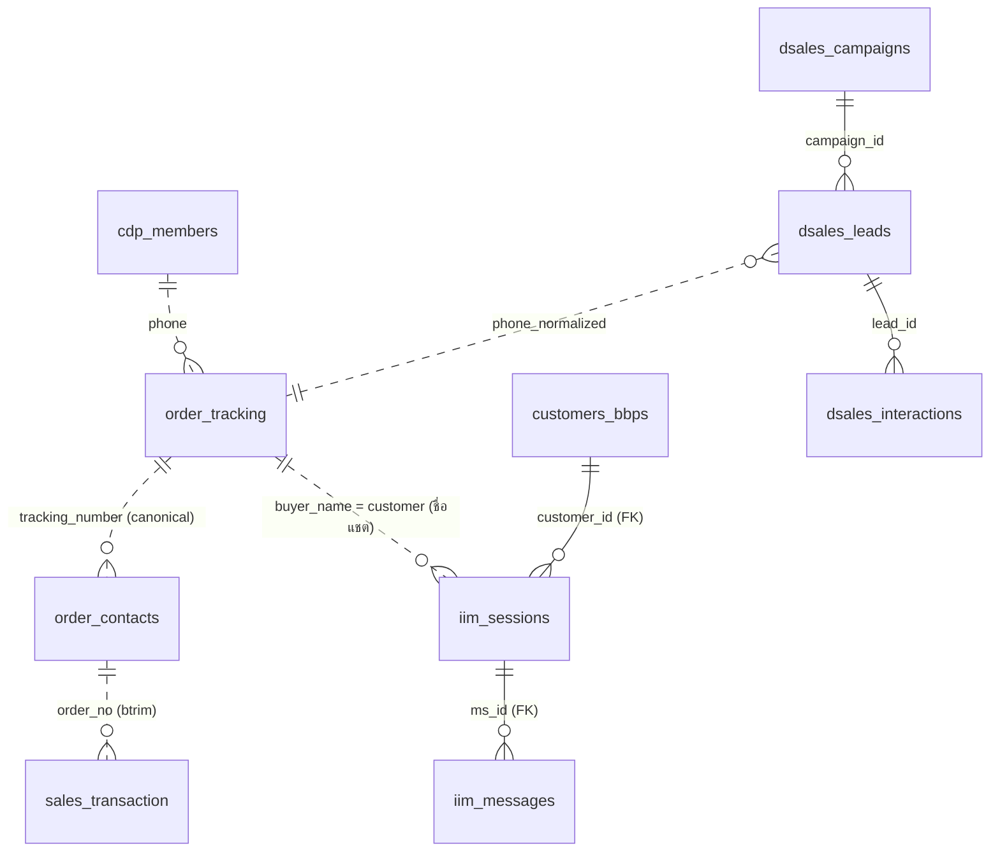

# MPD Direct Sale · โครงสร้างฐานข้อมูล

> สำรวจจาก Supabase project `nroyacasuchqniaiuirk` (production ที่ใช้ร่วมกับระบบอื่นของบริษัท: MRP, HR, CDP, bot ฯลฯ — ห้ามแก้ schema อื่นนอกจาก `dsales`)
>
> **อัปเดต 2026-11-19 (แผน C):** หัวข้อ 3, 4, 5.5 และ 6 ตรงกับ migration ใน `supabase/migrations/` (ทุกอย่างของ Direct Sale อยู่ใน schema `dsales` แล้ว) และหน้าเว็บ Next.js
> ตัวเลขจำนวนแถวและข้อสังเกตด้านข้อมูล (หัวข้อ 2, 5.1–5.4) ยังเป็นผลสำรวจเดิมของ 2026-11-17

## 1. ภาพรวมการเชื่อมข้อมูล

- **คีย์หลักของลูกค้าคือเบอร์โทร** (ใช้ `public.normalize_phone_th()` และ `dsales_valid_phone()`)
- Customer 360 กลางอยู่ที่ `customer_identities` / `customer_identity_links` (`identity_id` ใน `dsales_leads`)
- เส้นทึบ = foreign key จริง, เส้นประ = จับคู่ด้วยค่า (ไม่มี constraint)

## 2. ตารางแหล่งข้อมูล (มีอยู่แล้ว)

### `public.order_tracking` · ~43.6k แถว · ใช้หาตัวลูกค้า / ร้าน / ชื่อแชต
| คอลัมน์ | ชนิด | หมายเหตุ |
|---|---|---|
| id | uuid | PK |
| online_order | text | เลขออเดอร์บนแพลตฟอร์ม |
| tracking_number | text | ใช้เชื่อมกับ `order_contacts` (ตัดอักขระพิเศษ + upper) |
| phone | text | **คีย์ลูกค้า** |
| platform, shop | text | ช่องทาง/ร้าน (แปลงผ่าน `cdp.shops`, `dsales_norm_platform`) |
| logistics, order_status | text | |
| buyer_account_no | text | บัญชีผู้ซื้อ (มีค่า ~40k แถว) — ตอนนี้จับคู่กับ iim ไม่ได้ |
| buyer_name | text | ชื่อผู้ซื้อ / ชื่อแชต — ใช้จับคู่ `iim_sessions.customer` |
| source_file, created_at, updated_at | | |

> ⚠️ **ไม่มีคอลัมน์ `Customer_ID`** ตัวระบุลูกค้าคือ `phone` (+ `buyer_name`, `buyer_account_no`)

### `public.sales_transaction` · ~271.8k แถว · รายการขายรายบรรทัด (บิล/SKU)
| คอลัมน์ | ชนิด | หมายเหตุ |
|---|---|---|
| id | uuid | PK |
| bill_no, order_no, invoice_no | text | `order_no` ใช้เชื่อม `order_contacts` |
| order_status, txn_date, transfer_date | | |
| customer_code, customer_group1, customer_group2 | text | |
| sku, product_name, product_group | text | |
| unit_price, quantity, amount, sell_price, shipping_cost | numeric | |
| salesperson | text | ชื่อพนักงานขาย (text ไม่ใช่ FK) |
| channel_id | uuid | |
| project, keyword, source_type, source_file, line_seq, numeric_order_sku_key | | `numeric_order_sku_key` unique |

> ไม่มีเบอร์โทร **เส้นที่ใช้ได้จริง:** `btrim(sales_transaction.bill_no) = btrim(order_tracking.online_order)` → `order_tracking.phone`
> (ตรวจ 2026-11-17: บิล ต.ค.–พ.ย. 2026 ผูกได้ 5,342 / 6,001 = 89%)
> เส้นเดิม `order_no → order_contacts → tracking_number` ใช้กับข้อมูลช่วงหลังไม่ได้แล้ว (`order_contacts` มีแค่ ~2.8k แถว ผูกบิลช่วงเดียวกันได้ 0)
> และ `iim_messages.sender` เป็นชื่อเพจ/`[admin]` ไม่ใช่ชื่อแอดมิน (ดูข้อ 5.3)

### `cdp.members` · ~3.3k แถว · สมาชิก CRM
`id uuid, phone, phone_verified_at, first_name, last_name, gender, birth_date, email, source, status, merged_into, is_test, address jsonb, email_bounced_at, deleted_at, deleted_by, delete_reason, created_at, updated_at`

> ชื่อจริงคือ **`cdp.members`** (มี s) คีย์เชื่อมคือ `phone` · ควรกรอง `is_test`, `deleted_at`, `merged_into`

### `public.iim_sessions` · ~29.8k แถว · ห้องแชตจาก JST
| คอลัมน์ | ชนิด | หมายเหตุ |
|---|---|---|
| ms_id | bigint | PK (session id ของ JST) |
| customer | text | **ชื่อแชตของลูกค้า** (มี index `lower(btrim(customer))`) |
| channel | text | Facebook 19.4k, Shopee 4.3k, Instagram 3.7k, Line 1.8k, TikTok 349, Lazada 330, WebChat 2 |
| page | text | เพจ/ร้าน |
| msg_type, account_type, session_tag, tags jsonb, remark | | |
| mop_id, mop_status, order_status | text | |
| no_read_count, msg_count | int | |
| last_time, fetched_at | timestamptz | |
| customer_id | text | FK → `customers_bbps(id)` มีค่าแค่ ~894 แถว (3%) |
| from_ads | boolean | |

### `public.iim_messages` · ~711.5k แถว · ข้อความแชต (2024-08 → ปัจจุบัน)
| คอลัมน์ | ชนิด | หมายเหตุ |
|---|---|---|
| id | bigint | PK |
| ms_id | bigint | FK → `iim_sessions` (ON DELETE CASCADE) |
| time | timestamptz | ⚠️ ดูข้อ 5.2 |
| dir | text | `admin` / `customer` |
| fmt | text | txt, image, video, audio, file, expression, product, order, share, template, bundlemessage, storymention, shopssfeedback, **autoreply, system, systemnotice, error** |
| text, sender | text | `sender` = ชื่อแอดมินใน JST (34 ชื่อ) |
| media_urls | text[] | |

ตารางประกอบ: `iim_run_logs` (log การดึงแชต ~ทุก 39 นาที), `iim_updater_checkpoint`

## 3. ตาราง Direct Sale (schema `dsales`)

| ตาราง / view | คอลัมน์หลัก | การเข้าถึงจากหน้าเว็บ |
|---|---|---|
| `dsales_members` | user_id, role (`admin`/`sales`), display_name, active, jst_tags[], created_at | อ่าน/แก้ผ่าน RPC เท่านั้น (ถอน insert/update/delete/truncate จาก `authenticated`) |
| `dsales_campaigns` | id, brand, name, description, start_date, end_date, claim_mode (`self`/`assign`/`auto`), max_per_rep, criteria jsonb, active, created_by | RLS: อ่าน = สมาชิก active, insert/update = หัวหน้า (หน้าแคมเปญสร้าง, หน้าตั้งค่าแก้ `claim_mode`) |
| `dsales_leads` | id, campaign_id, source (`self`/`campaign`), brand, name, phone, phone_normalized, identity_id, address, shop, chat_name, channels jsonb, owner_id, last_seller_id, claimed_by, claimed_at, status, callback_date, interest, closed_bills[], closed_amount, closed_at, no_call, no_call_by, no_call_at, released_by[], auto_skip, created_by | RLS อ่าน: หัวหน้าทุกแถว / สมาชิก active เฉพาะที่ตัวเองดูแล; เขียนผ่าน RPC |
| `dsales_interactions` | id, lead_id, type (`call`/`chat`), result, note, bills[], due, rep_id, created_at, outreach_id (→ `dsales_outreach_queue`, แถวที่ worker ส่งให้) | RLS ตามลีด; เขียนผ่าน `dsales_log` / `dsales_worker_report` |
| `dsales_customer_base` | phone_normalized (PK), identity_id, name, chat_name, last_order_date, dormant_days, order_count, ltv, segment, rfm_segment, brands[], owner_tag, owner_id, eligible, refreshed_at | **ภายใน — ไม่มี grant ให้ `authenticated`/`anon`** อ่านผ่าน `dsales_base_customers` เท่านั้น (ดูหัวข้อ "ฐานลูกค้าและ cron" ด้านล่าง) |
| `dsales_chat_links` | ms_id, phone_normalized, method, evidence, confidence, linked_at | ภายใน — ห้าม grant |
| `dsales_settings` | key, value jsonb (เช่น `dormant_days`), updated_at | ภายใน — ห้าม grant |
| `dsales_chat_messages_v` (view) | ข้อความแชต JST พร้อมเวลาที่แก้ความเร็วเกิน 7 ชม. แล้ว | ใช้ภายในฟังก์ชันตรวจแชต |
| `dsales_templates` | id, brand, name, body, active, created_by, created_at, updated_at | ภายใน — ผ่าน RPC template เท่านั้น |
| `dsales_outreach_batches` | id, requested_by, template_id, brand, total, skipped jsonb `[{phone, reason}]`, created_at | ภายใน — ผ่าน RPC outreach เท่านั้น |
| `dsales_outreach_queue` | id, batch_id, lead_id, phone_normalized, ms_id, page, provider, chat_name, message_text, requested_by, status (`queued`/`sending`/`sent`/`failed`/`cancelled`), attempts, error, enqueued_at, locked_at, locked_by, sent_at, jst_msg_id, test_redirect, target_ms_id | ภายใน — ผ่าน RPC outreach / worker เท่านั้น |
| `dsales_worker_status` | worker_id (PK), user_id, heartbeat_at, jst_session_ok, state (`running`/`paused`/`needs_login`/`stopped`), sent_last_hour, queue_waiting, last_error, updated_at | ภายใน — เขียนผ่าน `dsales_worker_heartbeat`, อ่านผ่าน `dsales_worker_status_get` |
| `dsales_worker_state` | worker_id (PK), runtime (jsonb: state, sessionOk, lastError, failures, pausedUntil, loginTimes, pendingReports, linkTargets, linkPausedUntil, lastJstOkAt), lease_until, updated_at | ภายใน — สถานะข้ามรอบของ worker บน Vercel ผ่าน `dsales_worker_state_begin` / `_state_end` เท่านั้น · cookie ของ JST อยู่ใน Vault `dsales_jst_session_<worker_id>` |
| `dsales_rfm_segments` | key (PK), sort_order, f_min, f_max, r_min, r_max, is_fallback, tone, behavior, action, template_bebeplay, template_hosttail, no_outreach, updated_at, updated_by | ภายใน — ไม่มี grant · กติกา + Action Context ของ 10 กลุ่ม RFM (`dsales_rfm(orders, days)` อ่านตารางนี้) หน้าเว็บอ่านผ่าน `dsales_rfm_config_get` |

### คิวส่งข้อความ (outreach)

migration `20261120100000`–`20261120100600` (test `supabase/tests/08_*`–`08g_*`), spec `docs/superpowers/specs/2026-11-20-jst-outreach-worker-design.md`, สัญญา DB/worker/เว็บ `docs/superpowers/plans/2026-11-20-outreach-contract.md`:
- เซลล์เลือกลูกค้า (สูงสุด `outreach_max_batch` = 50 เบอร์) + template → `dsales_enqueue_outreach` จองลูกค้าจากถังให้เซลล์ (กติกาเดียวกับ `dsales_claim_customer`) แล้วเขียน batch + แถวคิว worker บนเครื่อง dev (บัญชีใน `worker_user_ids`) ดึงทีละรายการด้วย `dsales_worker_claim` ส่งผ่าน JST แล้วรายงานผล `dsales_worker_report`
- 4 ตารางใหม่เปิด RLS แต่ไม่มี policy และไม่มี grant (ตั้งใจ ปิดการเข้าถึงตรง) — advisor แจ้ง `rls_enabled_no_policy` (INFO) เป็นเรื่องปกติ
- ห้องแชตที่ส่ง (`dsales_outreach_room`): ห้องที่ผูกกับเบอร์ (`dsales_chat_links`) บนเพจของแบรนด์ (`page_brand_map`) LINE ก่อน → marketplace → Facebook/Instagram ห้องใหม่สุดก่อน; Facebook/Instagram ที่ลูกค้าไม่ได้ทักมาใน 24 ชม. ข้าม (`window_closed`) ไม่มีห้อง = `no_chat_room`
- template แทนค่า `{ชื่อ}`, `{ร้าน}` (ชื่อเพจ), `{สินค้าล่าสุด}`
- worker: ส่งทีละ 1 รายการ (`sending` ค้างเกิน 10 นาทีถูกปล่อยกลับคิว), เว้นระยะ `worker_interval_seconds` (ค่าเริ่ม 60), สลับเซลล์ (คนที่ส่งล่าสุดนานที่สุดก่อน), LINE ไม่เกิน `line_monthly_cap` ต่อเดือน (0 = ไม่จำกัด), requeue ได้สูงสุด 3 ครั้งแล้ว `failed` · ส่งสำเร็จ (โหมดปกติ) = เขียน `dsales_interactions` (`type = 'chat'`, `rep_id` = เซลล์ที่ขอ, `outreach_id`) และย้ายลีด `new` → `following`
- **โหมดทดสอบ = ส่งไปห้องทดสอบแทน (เปิดเป็นค่าเริ่ม `outreach_test_mode = true`)**: claim คืนงานตามปกติแต่ `target_ms_id` = ห้องแรกใน `outreach_test_ms_ids` และข้อความขึ้นต้น `[ทดสอบ → <ชื่อแชตหรือเบอร์>] ` (คิวบันทึก `test_redirect = true`, `target_ms_id`) รายงาน `sent` ของรายการทดสอบไม่เขียน interaction และไม่เปลี่ยนสถานะลีด · โหมดทดสอบแต่ไม่มีห้องทดสอบ = claim คืน `null` (ไม่ส่งอะไร) · โหมดปกติ `target_ms_id = ms_id` · worker ต้องส่ง `message` ไปที่ `target_ms_id` เสมอ
- settings ใหม่ใน `dsales_settings`: `worker_user_ids` (`["<uid ของ dev@mpdgroup.co>"]`), `worker_interval_seconds` 60, `outreach_max_batch` 50, `outreach_test_mode` true, `outreach_test_ms_ids` `[]`, `line_monthly_cap` 0, `page_brand_map` (`{bebeplay: [...], hosttail: [...]}`) · `worker_primary` (`"office-1"` — ผู้ใช้เลือกให้คงเป็นตัวหลัก, `vercel` เป็นตัวสำรอง), `worker_tick_enabled` (`false`)

### สิทธิ์เข้าใช้ (members-only)

migration `20261117100000_dsales_members_only.sql`, `20261117100100_dsales_access_hardening.sql`, `20261117100200_dsales_revoke_truncate.sql`:
- เข้าใช้ได้เฉพาะแถวใน `dsales_members` ที่ `active = true` — `dsales_uid()` โยน `not_authenticated` (ไม่มี session) / `not_member` (ไม่ใช่สมาชิก active) และทุก RPC ที่คืนข้อมูลลูกค้าเรียกฟังก์ชันนี้ บัญชีอื่นของบริษัทล็อกอินได้แต่เรียก RPC ข้อมูลไม่ได้ (`dsales_me` ตอบแค่ว่าไม่ใช่สมาชิก หน้าเว็บแสดงการ์ด "ยังไม่มีสิทธิ์ใช้งาน")
- `dsales_register()` **ไม่เพิ่มสมาชิกอัตโนมัติแล้ว** (เหลือแค่ตรวจสิทธิ์) หัวหน้าเพิ่มสมาชิกด้วยอีเมลในหน้าตั้งค่า (`dsales_add_member` บัญชีต้องมีใน `auth.users` อยู่แล้ว) ต้องมีหัวหน้า active อย่างน้อย 1 คนเสมอ (`last_admin`) และปิดใช้งานตัวเองไม่ได้ (`cannot_deactivate_self`)
- RLS ของตารางต้องเป็นสมาชิก active (`dsales_is_member()`) ห้ามเขียน `dsales_members` ตรง ๆ RPC จัดการสมาชิกใช้ advisory lock
- หน้าเว็บ (Next.js) ไม่เขียนตารางตรงยกเว้น `dsales_campaigns` (insert/update ตาม RLS ของหัวหน้า)

### ฐานลูกค้าและ cron

- `dsales_customer_base` คำนวณใหม่ด้วย `dsales_refresh_customer_base()` เรียกโดย **pg_cron job `dsales-refresh-customer-base` วันละ 3 รอบ 07:05, 12:05, 16:05 น.** (`5 0,5,9 * * *` UTC: `dsales_seed_chat_links_by_name()` แล้ว `dsales_refresh_customer_base()`) ไม่มี RPC ให้หน้าเว็บสั่ง refresh เอง
- เปลี่ยนจากรายชั่วโมงเป็นวันละ 3 รอบเมื่อ 2026-11-19 (ข้อมูลต้นทาง ออเดอร์/ยอดขาย เข้าวันละไม่กี่ครั้ง) และ **เขียนเฉพาะแถวที่เปลี่ยน** (migration `20261119120000_dsales_diff_refresh.sql`, Supabase `dsales_diff_refresh`): ลบแถวที่หลุด เพิ่มแถวใหม่ แก้แถวที่ค่าเปลี่ยน แถวที่เหมือนเดิมไม่แตะ ผลลัพธ์เท่าเดิม รอบแรกของวันยังแก้ ~9,100 แถวเพราะ `dormant_days` เพิ่มวันละ 1 · `refreshed_at` / `linked_at` จึงหมายถึงเวลาที่แถวนั้นถูกเขียนล่าสุด
- refresh ใช้ `pg_advisory_xact_lock(hashtext('dsales_refresh_customer_base'))` กันรันซ้อน · ฐานข้อมูลใช้ร่วมหลายแอป งานนี้อ่านตารางออเดอร์/ยอดขายทั้งก้อน อย่าเพิ่มรอบโดยไม่จำเป็น
- **`brands` = แบรนด์จาก CDP (`public.identity_brands`) รวมกับแบรนด์ของเพจที่ห้องแชตของลูกค้าอยู่** (migration `20261126100000_dsales_chat_page_brands.sql`, test `supabase/tests/25_chat_page_brands.sql`): ทุกห้องที่ผูกกับเบอร์ใน `dsales_chat_links` (ห้องใน `iim_sessions` + ห้องที่มีเฉพาะใน `dsales_jst_rooms`) จับคู่ชื่อเพจกับ setting `page_brand_map` ผลลัพธ์เรียงตามตัวอักษรไม่ซ้ำ · นับทุกห้องไม่ว่าจะส่งข้อความได้หรือไม่ (ห้องหมดอายุก็นับ — ต่างจาก `chat_brands` ที่นับเฉพาะห้องที่ส่งได้) · เพจที่ไม่อยู่ใน `page_brand_map` (Bebekim, Bebeshop, Mothery …) ไม่ให้แบรนด์ · เดิมใช้ `identity_brands` อย่างเดียว ซึ่งหยุดอัปเดตตั้งแต่ 2026-06-21 ลูกค้าที่เข้าเกณฑ์ 68% จึงไม่มีแบรนด์ (คอลัมน์แบรนด์ขึ้น "–", ตัวกรองแบรนด์ซ่อน, จองต้องเลือกแบรนด์เอง) หลังแก้เหลือ 47% (5,971 → 4,143 ราย; ลูกค้าที่ติด tag Admin 1,190 → 187 ราย) · แก้ `page_brand_map` หรือห้องถูกผูกใหม่ มีผลตอน cron รอบถัดไป · **ถังของหน้าแคมเปญ (`dsales_customer_pool_v3/v4`) ยังอ่าน `identity_brands` ตรง ๆ ไม่ได้เปลี่ยน**
- การเปลี่ยน tag ของห้องแชตฝั่ง JST มีผลกับ `owner_tag` ตอน cron รอบถัดไปเท่านั้น
- **หัวหน้าบันทึก tag (`dsales_set_member_tags`) และปิด/เปิดใช้งานสมาชิก (`dsales_set_member_active`) ไม่เรียก refresh เต็มแล้ว** (migration `20261119130000_dsales_set_member_tags_fast.sql`, test `supabase/tests/07_member_tags_fast.sql`): refresh เต็มเกิน `statement_timeout` 8 วินาทีของ role `authenticated` ฟังก์ชันทั้งสองจึงอัปเดต `dsales_customer_base.owner_id` ในที่เดิมจาก `owner_tag` ที่คำนวณไว้แล้ว (กติกา tagmap เดียวกับ refresh: tag ของสมาชิก active, ไม่สนตัวพิมพ์, tag ซ้ำ = `user_id` น้อยสุด; ~0.04 วินาที) ผลคือบันทึก tag แล้วลูกค้าของ tag นั้นเปลี่ยนเจ้าของทันที และปิดใช้งานสมาชิก = เสียความเป็นเจ้าของตาม tag ทันที (เปิดใช้งานคืน = ได้คืนทันที)

## 4. ฟังก์ชัน (RPC) ฝั่ง Direct Sale

อยู่ใน schema `dsales` ทั้งหมด เป็น `SECURITY DEFINER` + `set search_path = dsales, public` + `revoke … from public, anon` / `grant execute … to authenticated` หน้าเว็บเรียกผ่าน `lib/api/rpc.ts` เท่านั้น (error แปลเป็นไทยด้วย `toThaiError` แล้วโยนเป็น `RpcError`)

| ฟังก์ชัน | หน้าที่ | หน้าเว็บที่ใช้ |
|---|---|---|
| `dsales_me()` | user_id, email, display_name, is_admin, is_member, active (ไม่เรียก `dsales_uid` ทุกคนที่ล็อกอินเรียกได้) | ตอนเปิดแอป (ไม่ใช่สมาชิก active = การ์ดไม่มีสิทธิ์ ไม่โหลดข้อมูลอื่น) |
| `dsales_team()` | สมาชิกทั้งหมด (user_id, display_name, role, active, email) | shell, ตาราง, ตั้งค่า |
| `dsales_add_member(p_email, p_role)` / `dsales_set_member_active(p_user, p_active)` | หัวหน้าเพิ่ม/เปิดใช้งานใหม่ (อีเมลเดิม = เปิดใช้งาน + ตั้งบทบาทใหม่) และปิดใช้งานสมาชิก (advisory lock, `last_admin`, `cannot_deactivate_self`); `set_member_active` ปรับ `owner_id` ของฐานลูกค้าตามทันที | ตั้งค่า |
| `dsales_jst_admin_tags()` / `dsales_member_tags()` / `dsales_set_member_tags(p_user, p_tags)` | tag `Admin_*` จาก JST พร้อมจำนวนห้องแชต (หัวหน้า), tag ของสมาชิก, หัวหน้าผูก tag (1 tag ต่อ 1 คน ไม่สนตัวพิมพ์ ซ้ำ = `tag_taken: <tag>`) แล้วปรับ `owner_id` ในฐานลูกค้าในที่เดิม | ตั้งค่า |
| `dsales_my_leads(p_limit, p_offset)` | ลีดของฉัน + ลีดแคมเปญที่ยังไม่มีเจ้าของ (หัวหน้าเห็นทั้งหมด) หน้าเว็บขอ 1,000 | ตอนเปิดแอป |
| `dsales_customer_pool_v4(p_search, p_limit, p_offset, p_from, p_to, p_brand)` | ถังลูกค้าทั้งหมดของแบรนด์ + สถานะจอง (lead_id, taken, mine, no_call, reserved_by) สูงสุด 100/หน้า | หน้าแคมเปญ (ถัง) |
| `dsales_customer_pool_v3(…)` | รุ่นเดิม | นับลูกค้าทั้งแบรนด์ (`p_limit: 1` อ่าน `total_count`) ครั้งเดียวต่อแบรนด์ |
| `dsales_base_customers(p_scope, p_search, p_limit, p_offset, p_brand)` | ฐานลูกค้าเก่า (`dsales_customer_base` เฉพาะ `eligible`) ตาม scope `mine` (ของฉันตาม tag/ลีด) / `pool` (ไม่มีเจ้าของ) / `team` (หัวหน้าเท่านั้น) + dormant_days, owner_tag | `/mine`, `/pool` |
| `dsales_rfm_config_get()` | กติกา + Action Context ของ 10 กลุ่ม RFM เรียงตามลำดับเช็ก | ตอนเปิดแอป |
| `dsales_rfm_map(p_scope, p_brand, p_as)` | จำนวนลูกค้าต่อกลุ่ม: `n` ทุกคนในขอบเขต, `contactable` เฉพาะที่ไม่ซื้อมา ≥ 30 วัน (`''` = ยังไม่มีกลุ่ม) | `/rfm` |
| `dsales_customer_purchases(p_phone)` / `dsales_customer_channels(p_phone)` | ประวัติซื้อ (สูงสุด 200 แถว) / ช่องทาง-ร้านที่เคยสั่ง | popup ลูกค้า, popup ถัง, หลังจอง |
| `dsales_customer_chats(p_phone, p_since)` | แชต JST + จำนวนข้อความฝั่งแอดมินหลัง `p_since` (ไม่นับ autoreply/system/error) | ตรวจการทักแชต |
| `dsales_claim_customer(p_phone, p_brand)` | จองลูกค้าจากถัง/ฐานลูกค้า (สร้างลีด `self` หรือจองลีดเดิม; ของเซลล์อื่นตาม tag = `taken`) | ถัง, `/mine`, `/pool` |
| `dsales_claim_lead(p_lead)` / `dsales_unclaim_lead(p_lead)` | จองลีดแคมเปญ / ยกเลิกจอง·คัดออก | หน้าแคมเปญ, ตาราง, popup |
| `dsales_assign_lead(p_lead, p_user)` | หัวหน้ามอบหมายลีด | หน้าแคมเปญ |
| `dsales_log(p_lead, p_type, p_result, p_note, p_status, p_callback, p_interest, p_bills, p_amount)` / `dsales_set_nocall(p_lead, p_on)` | บันทึกโทร/แชต + สถานะ / ห้ามโทร | popup บันทึก, ตาราง |
| `dsales_uid()`, `dsales_is_admin()`, `dsales_is_member()` | ตรวจสิทธิ์ (ใช้ใน RPC และ RLS) | — ไม่เรียกตรง |
| `dsales_register()` | ตรวจสิทธิ์เท่านั้น (ไม่เพิ่มสมาชิกแล้ว) | — |
| `dsales_refresh_customer_base()`, `dsales_seed_chat_links_by_name()` | งานเบื้องหลัง (pg_cron วันละ 3 รอบ) — ไม่มี grant ให้ `authenticated` | — |
| `dsales_lead_json` (JSON ของลีดที่ทุก RPC คืน — รวม `rfm` / `dormantDays` จาก `dsales_customer_base` ตั้งแต่ 20261126140000), `dsales_norm_phone`, `dsales_norm_platform`, `dsales_valid_phone`, `dsales_touch_updated_at` | helper / trigger | — |
| `dsales_templates_list(p_brand)` / `dsales_template_save(p_id, p_brand, p_name, p_body, p_active)` | template ข้อความต่อแบรนด์ (เซลล์เห็นเฉพาะ active; หัวหน้าสร้าง/แก้ — `forbidden`, `invalid_template`, `not_found`) | หน้าตั้งค่า, popup ส่งข้อความ |
| `dsales_outreach_preview(p_phones, p_template)` / `dsales_enqueue_outreach(p_phones, p_template)` | ดูตัวอย่างข้อความ + ห้อง + เหตุผลที่ข้าม (`customer_not_found`, `taken`, `already_queued`, `no_chat_room`, `window_closed`) / จองลูกค้าแล้วเข้าคิว (`{batch_id, queued, skipped}` เพิ่ม `no_call`, `claim_failed`) · `template_not_found`, `batch_too_large` | popup ส่งข้อความใน `/mine` `/pool` |
| `dsales_outreach_batches_mine(p_limit, p_offset)` / `dsales_outreach_batch(p_batch)` / `dsales_outreach_cancel(p_ids)` | รายการชุดส่ง + จำนวนตามสถานะ (หัวหน้าเห็นทุกชุด) / รายละเอียดชุด (`not_found`, `forbidden`) / ยกเลิกรายการที่ยัง `queued` | หน้า `/outreach` |
| `dsales_worker_status_get()` / `dsales_worker_settings_set(p_interval, p_line_cap, p_test_mode, p_test_ms_ids)` | สถานะ worker (online = heartbeat ไม่เกิน 3 นาที) + คิว + ค่าตั้ง / หัวหน้าตั้งค่า (`forbidden`, `invalid_setting`: interval 5–3600, cap ≥ 0) · ผลมี `primary` และ `is_primary` ต่อ worker | หน้าตั้งค่า (การ์ด Worker) |
| `dsales_worker_find_rooms(p_query)` | หัวหน้าค้นห้องใน `public.iim_sessions` ด้วยชื่อลูกค้า (ขึ้นต้น/มีคำนั้น ไม่สนตัวพิมพ์) สูงสุด 20 ห้อง ใหม่สุดก่อน → `[{ms_id, customer, channel, page, last_time}]` · คำค้นสั้นกว่า 2 ตัว = `[]` · `forbidden` (~0.1 วินาที) | หน้าตั้งค่า (เลือกห้องทดสอบ) |
| `dsales_worker_claim(p_worker)` / `dsales_worker_report(p_id, p_status, p_error, p_jst_msg_id)` / `dsales_worker_heartbeat(p_worker, p_state, p_session_ok, p_last_error)` | **worker เท่านั้น** (ตรวจ `worker_user_ids` ด้วย `dsales_worker_uid()` → `not_worker`): ดึงงานถัดไป (`{id, ms_id, target_ms_id, test_redirect, page, provider, chat_name, message, attempts, enqueued_at, requested_by}` หรือ `null`) / รายงาน `sent`·`failed`·`requeue` (`not_found`, `invalid_state`, `invalid_status`) / heartbeat | `tools/jst-worker` (แผน D2) |
| `dsales_worker_state_begin(p_worker, p_lease_seconds)` / `dsales_worker_state_end(p_worker, p_runtime, p_cookies)` / `dsales_worker_session_put(p_worker, p_cookies)` | **worker เท่านั้น**: เริ่มรอบ (คืน `null` ถ้ารอบอื่นถือ lease อยู่ ไม่เช่นนั้น `{runtime, cookies}` และถือ lease 90 วินาที — ขั้นต่ำ 70 วินาที ต้องยาวกว่า `maxDuration` 60 วินาทีของ route) / จบรอบ (บันทึก runtime, เขียน cookie ลง Vault เมื่อไม่เป็น null, ปล่อย lease; runtime เกิน 64 KB = `invalid_runtime`) / อัปโหลด session ที่คนล็อกอินเอง (ปลด `needs_login` และล้าง `failures` / `loginTimes`; `worker_busy` ขณะรอบหนึ่งถือ lease อยู่; cookie ว่างหรือเกิน 64 KB = `invalid_cookies`) · `invalid_worker` | `tools/jst-worker/tick.mjs`, `import-session.mjs --upload` |
| `dsales_worker_primary_set(p_worker)` / `dsales_worker_state_reset(p_worker)` | หัวหน้า: ตั้งตัวหลัก (`''` = ไม่มีตัวหลัก, `unknown_worker` ถ้าไม่เคยส่ง heartbeat) / ล้าง runtime + lease ของ worker id ใดก็ได้ที่มีแถวใน `dsales_worker_state` (หัวหน้าเท่านั้น; `worker_busy` ขณะรอบหนึ่งถือ lease อยู่) — ปุ่มบนการ์ด Worker เท่านั้นที่จำกัดให้ใช้กับ worker บน Vercel ที่ `stopped` · คืนผลแบบ `dsales_worker_status_get` (`forbidden`) | หน้าตั้งค่า (การ์ด Worker) |
| `dsales_worker_is_standby`, `dsales_worker_session_write`, `dsales_tick_kick` | ภายใน (ไม่มี grant): กติกาตัวสำรองที่ `dsales_worker_claim` / `dsales_worker_link_targets` ใช้ · เขียน Vault (ปฏิเสธ cookie ว่าง/เกิน 64 KB) · ตัวปลุกของ cron `dsales-outreach-tick` | — |

รหัส error ของ RPC worker บน Vercel / ตัวหลัก: `worker_busy` (รอบหนึ่งถือ lease อยู่ — `session_put`, `state_reset`), `invalid_worker` (ชื่อ worker ไม่ตรง `^[A-Za-z0-9_-]{1,64}$`), `invalid_runtime` (runtime ไม่ใช่ object หรือเกิน 64 KB), `invalid_cookies` (ไม่ใช่ array, ว่าง หรือเกิน 64 KB), `unknown_worker` (`primary_set` ชื่อที่ไม่เคยส่ง heartbeat), `forbidden` (ไม่ใช่หัวหน้า)
| `dsales_outreach_room`, `dsales_outreach_plan`, `dsales_setting`, `dsales_template_json`, `dsales_worker_settings_json` | ภายใน (ไม่มี grant ให้ `authenticated`) | — |

ทุก migration อยู่ใน `supabase/migrations/` (เริ่มจาก `20261117090000_baseline_public_dsales_functions.sql`) พร้อม SQL test ใน `supabase/tests/` (`01`–`08g`) — ขั้นตอนเพิ่ม migration ดู `CLAUDE.md`

### ผูกห้องแชตด้วยรหัสผู้ซื้อ (buyer ID)

migration `20261120150000_dsales_buyer_id_room_links.sql` (test `supabase/tests/10_buyer_id_room_links.sql`):
- JST ค้นห้องด้วย "รหัสผู้ซื้อออนไลน์" ได้ (`/iim/getSessions` + `query_type: 'outer_user_id'`) และ `outer_user_id` ของห้อง = `order_tracking.buyer_account_no` (LINE MiniShop = LINE userId, FB = PSID, Shopee/Lazada = buyer id; TikTok ไม่พบห้อง) — ตรวจ 2026-11-20: สุ่มรหัสของลูกค้าที่ยังไม่มีห้อง 40 รหัส พบห้อง FB 12/12, LINE 7/7, Shopee 7/7, Lazada 5/12 (ทุกห้อง `is_expired`), TikTok 0/2 และ 31/32 ห้องที่พบ**ไม่อยู่ใน `iim_sessions`**
- worker ค้นตอนไม่มีงานส่ง: `dsales_worker_link_targets(p_worker, p_limit)` (รหัสบนร้าน FB_/LOA_/SH_/LA_/TT_/IG_ ของลูกค้า eligible ที่ยังไม่เคยค้น มูลค่าสูงก่อน แล้วค้นซ้ำทุก 14 วัน; ~0.6 วินาที) → `dsales_worker_link_save(p_worker, p_buyer_id, p_rooms, p_error)` เก็บห้องใน `dsales_jst_rooms` และผูก `dsales_chat_links` (`method = 'buyer_id'`, `confidence = 'high'`; คู่ที่เคยผูกด้วยชื่อถูกอัปเกรด, `manual` ไม่ถูกแตะ) — ทั้งสอง RPC ตรวจ `dsales_worker_uid()`
- รหัสที่สั่งซื้อด้วยเบอร์มากกว่า `dsales_link_max_phones()` = 3 เบอร์ (ตัวแทน/พนักงาน) ไม่ถูกผูก (`dsales_buyer_lookups.error = 'too_many_phones'`)
- ตารางใหม่ `dsales_jst_rooms` (ms_id, outer_user_id, provider, page, name, expired, last_message_time), `dsales_buyer_lookups` (ประวัติการค้นต่อรหัส) — RLS ไม่มี policy ไม่มี grant
- view `dsales_rooms_v` = `iim_sessions` (ค่าจาก JST ทับเมื่อมี) + ห้องที่มีเฉพาะใน `dsales_jst_rooms` · `dsales_outreach_room`, `dsales_customer_rooms`, `dsales_sendable_rooms`, ตัวกรองช่องทางของ `dsales_base_customers`, `dsales_worker_find_rooms` อ่านจาก view นี้
- `is_expired` ของ JST = ห้องส่งไม่ได้ (Lazada) แต่**ไม่ได้บอกช่วง 24 ชม. ของ Meta** (ห้อง FB เงียบ 2 เดือนยังเป็น false) → Facebook/Instagram ยังต้องมีข้อความลูกค้าใน 24 ชม. ตามเดิม
- `dsales_customer_rooms` ของห้อง Facebook/Instagram มี `outer_user_id` (PSID), `meta_page_id` (setting `meta_page_ids`: ชื่อเพจ → page id ของ Meta) และ `meta_business_id` (setting) — Business Suite ไม่รับ PSID เป็น `selected_item_id` (ทดสอบ 2026-11-20) จึงเปิดได้แค่ Inbox ของเพจ ไม่ใช่แชตของลูกค้าคนนั้น
- ประสิทธิภาพ (`20261123060000_dsales_sendable_rooms_fast.sql`, `20261123063000_dsales_room_lookup_fast.sql`): join กับ view แบบ UNION ALL ทำให้ planner hash ห้องทั้ง 31k ห้องต่อเบอร์ (`dsales_outreach_room` ×50 = 64 วินาที, ตัวกรอง has_chat 5.9 วินาที) — ฟังก์ชันรายเบอร์จึงอ่านห้องผ่าน `dsales_room_of(ms_id)` (SQL function ธรรมดา ไม่มี security definer/SET เพื่อให้ inline แล้วใช้ index; advisor เตือน mutable search_path โดยตั้งใจ ตัวฟังก์ชันอ้างชื่อเต็มทุกตาราง) และ `dsales_sendable_rooms` สร้างรายการห้องที่ผูกก่อน แล้วตรวจ 24 ชม. ของ FB/IG ด้วย `LATERAL … LIMIT 1` รายห้อง · หลังแก้: หน้า /mine /pool ปกติ 0.11 วินาที, has_chat 0.24 วินาที, preview 20 เบอร์ 0.08 วินาที (test 09 / 08d) — production ช้าอยู่ ~10 นาที (2026-11-23 10:49–10:59 น.) ไม่มีการส่งชุดในช่วงนั้น
- หน้า Direct Sale (2026-11-23): `dsales_rooms_for_phones(p_phones text[])` → `(phone, rooms)` โดย `rooms` = `dsales_customer_rooms(phone)` (มี `name` = ชื่อของห้องนั้นใน JST) เฉพาะเบอร์ของลีดที่ผู้เรียกเป็นเจ้าของ (หัวหน้าได้ทุกเบอร์) · เกิน 100 เบอร์ = `too_many_phones` (เว็บแบ่งส่งทีละ 100) · ~0.4 ms/เบอร์
- ผลข้างเคียง: `dsales_refresh_customer_base` เลือก `chat_name` / `owner_tag` (tag Admin_* ของ JST) จากห้องที่ผูกและอยู่ใน `iim_sessions` → ผูกห้องได้มากขึ้น = ลูกค้ามีเจ้าของจาก tag มากขึ้น

## 5. ข้อสังเกต / สิ่งที่ต้องแก้

### 5.1 การจับคู่แชต JST กับลูกค้ายังไม่แม่น
`dsales_customer_chats` จับคู่ด้วย **ชื่อแชต** (`iim_sessions.customer` = `buyer_name` / `customer_identities.display_name` / `lds_customers.jst_chat_name`)
- จับคู่ได้ ~4,616 / 29,800 sessions (~15%)
- ชื่อแชตซ้ำกัน 1,175 ชื่อ → เสี่ยงจับผิดคน
- `buyer_account_no` จับคู่กับ `iim_sessions.customer` / `mop_id` ได้ 0 แถว
- `iim_sessions.customer_id` มีค่าแค่ ~3% และชี้ไป `customers_bbps`

**แก้แล้วบางส่วน (2026-11-20):** ห้องแชตของคิวส่งข้อความผูกด้วยรหัสผู้ซื้อผ่าน worker แล้ว (ดูหัวข้อ "ผูกห้องแชตด้วยรหัสผู้ซื้อ") ส่วน `dsales_customer_chats` ยังจับด้วยชื่อ · เดิมแนะนำ: ให้ตัวดึงแชตเก็บ ID ผู้ซื้อของแต่ละแพลตฟอร์ม (Shopee buyer id, FB PSID, LINE userId ฯลฯ) ลง `iim_sessions` เพื่อผูกกับ `order_tracking.buyer_account_no` ได้แน่นอน

### 5.2 เวลาใน `iim_messages.time` น่าจะเพี้ยน timezone
ข้อความล่าสุดมีเวลาล้ำปัจจุบันราว 413 นาที (~7 ชม.) → น่าจะบันทึกเวลาไทยเป็น UTC
ต้องแก้ก่อนใช้ `p_since` ตรวจ "เซลล์ทักหลังจองหรือไม่"
✅ ฝั่ง Direct Sale แก้แล้ว: ฟังก์ชันตรวจแชตอ่านผ่าน view `dsales_chat_messages_v` ที่หักเวลา 7 ชม. (ข้อมูลดิบใน `iim_messages` ยังเพี้ยนเหมือนเดิม)

### 5.3 ยังผูกผู้ส่งใน JST กับเซลล์ไม่ได้
`iim_messages.sender` ไม่ใช่ชื่อแอดมิน: ใน 60 วันล่าสุดส่วนใหญ่เป็น `[admin]` (~161k) หรือชื่อเพจ/ร้าน เช่น `Bebeplay`, `SH_bebeplay`, `TT_hosttail` จึง map ไปหาเซลล์ไม่ได้
**แนวทาง (ดู spec `docs/superpowers/specs/2026-11-17-direct-sale-design.md`):** นับเฉพาะแชตที่ส่งผ่านคิวของระบบ ผู้ได้ผลงานคือผู้สั่งในคิว และยืนยันด้วย `ms_id` + ข้อความ + เวลา

### 5.4 ความถี่และความเสถียรของตัวดึงแชต
ดึงประมาณทุก 39 นาที · มีสถานะ `partial` 4 ครั้งใน 24 ชม. → การยืนยันว่าทักแล้วจะล่าช้าได้ ~40 นาที

### 5.5 อื่น ๆ
- ✅ frontend เป็น Next.js อ่าน/เขียนผ่าน RPC ใน schema `dsales` ทั้งหมด ไม่มีโหมดตัวอย่าง/`localStorage` ใน production (โหมด fixture มีเฉพาะ `next dev`)
- ✅ ตัด fallback "อีเมล `dev@mpdgroup.co` = หัวหน้า" แล้ว สิทธิ์มาจาก `dsales_me()` อย่างเดียว
- ✅ migration ของ `dsales` อยู่ใน `supabase/migrations/` ครบ (export baseline จาก DB แล้ว)
- ⚠️ ผลตรวจ "ทักแชตแล้ว" (ข้อ 6) ยังเก็บแค่ในหน่วยความจำของหน้าเว็บ (`lead.chatCheck`) รีเฟรชแล้วต้องตรวจใหม่
- ⚠️ funnel ของตัวสร้างแคมเปญยังเป็น 0 ตอนล็อกอินจริง (ไม่มี RPC กรองลูกค้าตามเงื่อนไข) และแคมเปญยังไม่สร้างลีดจาก `criteria` — เฟส 2
- ✅ cron `dsales-refresh-customer-base` ลดเป็นวันละ 3 รอบและเขียนเฉพาะแถวที่เปลี่ยนแล้ว (2026-11-19, ดูหัวข้อ 3) · tag ที่ติดใหม่ใน JST จึงเข้าระบบช้าสุดถึงรอบถัดไป (ข้ามคืนได้ ~15 ชม.)

## 6. ระบบ "ขุด → เปิดแชต JST → ตรวจว่าทักจริง"

| ขั้น | แนวทาง | สถานะใน branch ปัจจุบัน |
|---|---|---|
| 1 | เซลล์กดจอง → `dsales_claim_customer` บันทึก `claimed_at` | ✅ ทำแล้ว |
| 2 | เปิดแชตลูกค้าใน JST | ✅ ทำแล้วบางส่วน: ช่องทาง/ร้านมาจาก `dsales_customer_channels` แล้วส่งให้ตัวช่วยบนเครื่องเซลล์ (`tools/jst-helper`, ฟังที่ `127.0.0.1:47321`) เปิด JST ให้ ถ้าไม่ได้รันตัวช่วยจะเปิดลิงก์ตาม env `NEXT_PUBLIC_JST_URL_TEMPLATE` หรือคัดลอกชื่อแชตให้ไปค้นหาเอง · ⚠️ **ยังไม่รู้รูปแบบ URL/การเปิดแชตของ JST** (`NEXT_PUBLIC_JST_URL_TEMPLATE` ยังว่าง) |
| 3 | ตรวจด้วย `dsales_customer_chats(phone, claimed_at)` → `admin_msgs > 0` | ✅ ทำแล้ว: กดตรวจในหน้าลูกค้า และตรวจอัตโนมัติครั้งละไม่เกิน 10 ลีดที่จองแล้วแต่ยังไม่พบว่าทัก · ⚠️ ยังไม่เช็กว่า `last_admin_sender` เป็นเซลล์เจ้าของลีด (แค่แสดงชื่อ) ต้องทำข้อ 5.3 ก่อน และผลยังเพี้ยนได้จากข้อ 5.2 |
| 4 | บันทึกผลลง `dsales_interactions` (type = `chat`) อัตโนมัติ | ❌ ยังไม่ทำ ผลตรวจเก็บแค่ในหน้าเว็บ (ดูข้อ 5.5) |
