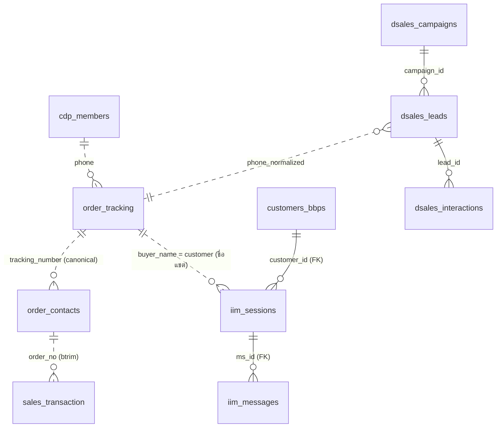

# MPD Direct Sale · โครงสร้างฐานข้อมูล

> สำรวจจาก Supabase project `nroyacasuchqniaiuirk` เมื่อ 2026-11-17 (อ่านอย่างเดียว)
> project นี้ใช้ร่วมกับหลายระบบ (MRP, HR, CDP, bot ฯลฯ) มี migration ราว 1,568 ตัว
> เอกสารนี้สรุปเฉพาะส่วนที่ Direct Sale ใช้หรือจะใช้ migration ส่วนใหญ่ไม่ได้อยู่ใน repo นี้ (มีแค่ `supabase/live-part1.sql`)
>
> **อัปเดต 2026-11-17:** หัวข้อ 3, 4, 5.5 และ 6 ปรับให้ตรงกับโค้ดใน branch `claude/serene-meitner-cprt82` (commit `ad3260d` "Live mode")
> ตัวเลขจำนวนแถวและข้อสังเกตด้านข้อมูล (หัวข้อ 2, 5.1–5.4) ยังเป็นผลสำรวจเดิม ไม่ได้ตรวจกับฐานข้อมูลซ้ำ

## 1. ภาพรวมการเชื่อมข้อมูล

- **คีย์หลักของลูกค้าคือเบอร์โทร** (ใช้ `public.normalize_phone_th()` และ `dsales_valid_phone()`)
- Customer 360 กลางอยู่ที่ `customer_identities` / `customer_identity_links` (`identity_id` ใน `dsales_leads`)
- เส้นทึบ = foreign key จริง, เส้นประ = จับคู่ด้วยค่า (ไม่มี constraint)

## 2. ตารางแหล่งข้อมูล (มีอยู่แล้ว)

### `public.order_tracking` · ~43.6k แถว · ใช้หาตัวลูกค้า / ร้าน / ชื่อแชต
| คอลัมน์ | ชนิด | หมายเหตุ |
|---|---|---|
| id | uuid | PK |
| online_order | text | เลขออเดอร์บนแพลตฟอร์ม |
| tracking_number | text | ใช้เชื่อมกับ `order_contacts` (ตัดอักขระพิเศษ + upper) |
| phone | text | **คีย์ลูกค้า** |
| platform, shop | text | ช่องทาง/ร้าน (แปลงผ่าน `cdp.shops`, `dsales_norm_platform`) |
| logistics, order_status | text | |
| buyer_account_no | text | บัญชีผู้ซื้อ (มีค่า ~40k แถว) — ตอนนี้จับคู่กับ iim ไม่ได้ |
| buyer_name | text | ชื่อผู้ซื้อ / ชื่อแชต — ใช้จับคู่ `iim_sessions.customer` |
| source_file, created_at, updated_at | | |

> ⚠️ **ไม่มีคอลัมน์ `Customer_ID`** ตัวระบุลูกค้าคือ `phone` (+ `buyer_name`, `buyer_account_no`)

### `public.sales_transaction` · ~271.8k แถว · รายการขายรายบรรทัด (บิล/SKU)
| คอลัมน์ | ชนิด | หมายเหตุ |
|---|---|---|
| id | uuid | PK |
| bill_no, order_no, invoice_no | text | `order_no` ใช้เชื่อม `order_contacts` |
| order_status, txn_date, transfer_date | | |
| customer_code, customer_group1, customer_group2 | text | |
| sku, product_name, product_group | text | |
| unit_price, quantity, amount, sell_price, shipping_cost | numeric | |
| salesperson | text | ชื่อพนักงานขาย (text ไม่ใช่ FK) |
| channel_id | uuid | |
| project, keyword, source_type, source_file, line_seq, numeric_order_sku_key | | `numeric_order_sku_key` unique |

> ไม่มีเบอร์โทร **เส้นที่ใช้ได้จริง:** `btrim(sales_transaction.bill_no) = btrim(order_tracking.online_order)` → `order_tracking.phone`
> (ตรวจ 2026-11-17: บิล ต.ค.–พ.ย. 2026 ผูกได้ 5,342 / 6,001 = 89%)
> เส้นเดิม `order_no → order_contacts → tracking_number` ใช้กับข้อมูลช่วงหลังไม่ได้แล้ว (`order_contacts` มีแค่ ~2.8k แถว ผูกบิลช่วงเดียวกันได้ 0)
> และ `iim_messages.sender` เป็นชื่อเพจ/`[admin]` ไม่ใช่ชื่อแอดมิน (ดูข้อ 5.3)

### `cdp.members` · ~3.3k แถว · สมาชิก CRM
`id uuid, phone, phone_verified_at, first_name, last_name, gender, birth_date, email, source, status, merged_into, is_test, address jsonb, email_bounced_at, deleted_at, deleted_by, delete_reason, created_at, updated_at`

> ชื่อจริงคือ **`cdp.members`** (มี s) คีย์เชื่อมคือ `phone` · ควรกรอง `is_test`, `deleted_at`, `merged_into`

### `public.iim_sessions` · ~29.8k แถว · ห้องแชตจาก JST
| คอลัมน์ | ชนิด | หมายเหตุ |
|---|---|---|
| ms_id | bigint | PK (session id ของ JST) |
| customer | text | **ชื่อแชตของลูกค้า** (มี index `lower(btrim(customer))`) |
| channel | text | Facebook 19.4k, Shopee 4.3k, Instagram 3.7k, Line 1.8k, TikTok 349, Lazada 330, WebChat 2 |
| page | text | เพจ/ร้าน |
| msg_type, account_type, session_tag, tags jsonb, remark | | |
| mop_id, mop_status, order_status | text | |
| no_read_count, msg_count | int | |
| last_time, fetched_at | timestamptz | |
| customer_id | text | FK → `customers_bbps(id)` มีค่าแค่ ~894 แถว (3%) |
| from_ads | boolean | |

### `public.iim_messages` · ~711.5k แถว · ข้อความแชต (2024-08 → ปัจจุบัน)
| คอลัมน์ | ชนิด | หมายเหตุ |
|---|---|---|
| id | bigint | PK |
| ms_id | bigint | FK → `iim_sessions` (ON DELETE CASCADE) |
| time | timestamptz | ⚠️ ดูข้อ 5.2 |
| dir | text | `admin` / `customer` |
| fmt | text | txt, image, video, audio, file, expression, product, order, share, template, bundlemessage, storymention, shopssfeedback, **autoreply, system, systemnotice, error** |
| text, sender | text | `sender` = ชื่อแอดมินใน JST (34 ชื่อ) |
| media_urls | text[] | |

ตารางประกอบ: `iim_run_logs` (log การดึงแชต ~ทุก 39 นาที), `iim_updater_checkpoint`

## 3. ตาราง Direct Sale (`dsales_*`) — frontend ใช้แล้วเมื่อล็อกอิน (Live mode)

| ตาราง | คอลัมน์หลัก |
|---|---|
| `dsales_members` | user_id, role, display_name, active, created_at |
| `dsales_campaigns` | id, brand, name, description, start_date, end_date, claim_mode, criteria jsonb, max_per_rep, active, created_by |
| `dsales_leads` | id, campaign_id, source, brand, name, phone, phone_normalized, identity_id, address, shop, chat_name, channels jsonb, owner_id, last_seller_id, claimed_by, claimed_at, status, callback_date, interest, closed_bills[], closed_amount, closed_at, no_call, no_call_by, no_call_at, released_by[], auto_skip, created_by |
| `dsales_interactions` | id, lead_id, type, result, note, bills[], due, rep_id, created_at |

ณ วันที่สำรวจ: leads 0 · interactions 0 · campaigns 0 · members 1 (ก่อนเปิดใช้ Live mode)

การเขียนข้อมูลจาก frontend:
- `dsales_leads` / `dsales_interactions` เขียนผ่าน RPC เท่านั้น (RLS ให้เซลล์อ่านได้เฉพาะลีดของตัวเอง หัวหน้าเขียนตรงได้) ดู `supabase/live-part1.sql`
- `dsales_campaigns` หน้าเว็บ `insert` / `update` ตารางตรง (สร้างแคมเปญ, เปลี่ยน `claim_mode`) สิทธิ์คุมด้วย RLS ของตาราง
- `dsales_members` เพิ่มตัวเองอัตโนมัติผ่าน `dsales_register()` ตอนล็อกอิน (role เริ่มต้น `sales`)

## 4. ฟังก์ชัน (RPC) ฝั่ง Direct Sale

ทั้งหมดอยู่ใน `public`, ส่วนใหญ่เป็น `SECURITY DEFINER`

| ฟังก์ชัน | หน้าที่ | frontend ใช้ |
|---|---|---|
| `dsales_me()` | ชื่อ (profiles) + is_admin (dsales_members) | ✅ ตอนล็อกอิน |
| `dsales_register()` | เพิ่มผู้ใช้ที่ล็อกอินเข้า `dsales_members` (ถ้ายังไม่มี) | ✅ ตอนโหลดข้อมูล |
| `dsales_team()` | รายชื่อทีม (หัวหน้าเห็นทุกคน เซลล์เห็นตัวเอง) | ✅ |
| `dsales_my_leads(p_limit, p_offset)` | ลีดของฉัน + ลีดแคมเปญที่ยังไม่มีเจ้าของ (หัวหน้าเห็นทั้งหมด) frontend ขอครั้งละ 1,000 | ✅ |
| `dsales_customer_pool_v4(p_search, p_limit, p_offset, p_from, p_to, p_brand)` | ถังลูกค้าทั้งหมด (ค้นหา/กรองช่วงวันที่) สูงสุด 100 แถว/หน้า | ✅ รายการหลัก |
| `dsales_customer_pool_v3(...)` | รุ่นเดิม | ✅ ใช้เฉพาะนับจำนวนลูกค้าทั้งแบรนด์ (`p_limit: 1` อ่าน `total_count`) |
| `dsales_customer_purchases(p_phone)` | ประวัติซื้อรายรายการ สูงสุด 200 แถว | ✅ |
| `dsales_customer_channels(p_phone)` | ช่องทาง/ร้านที่ลูกค้าเคยสั่ง (order_tracking + cdp.shops) | ✅ ปุ่มเปิดแชตแต่ละร้าน |
| `dsales_customer_chats(p_phone, p_since)` | แชต JST ของลูกค้า + จำนวนข้อความที่แอดมินส่งจริงหลัง `p_since` (ไม่นับ autoreply/system/error) | ✅ ตรวจว่าทักแชตแล้ว |
| `dsales_claim_customer(p_phone, p_brand)` | จองลูกค้าจากถัง (สร้างลีด) | ✅ |
| `dsales_claim_lead(p_lead)` / `dsales_unclaim_lead(p_lead)` | จองลีดแคมเปญ / ยกเลิกจอง·คัดออก | ✅ |
| `dsales_assign_lead(p_lead, p_user)` | หัวหน้ามอบหมายลีด | ✅ |
| `dsales_log(p_lead, p_type, p_result, p_note, p_status, p_callback, p_interest, p_bills, p_amount)` | บันทึกการโทร/แชต + อัปเดตสถานะ | ✅ |
| `dsales_set_nocall(p_lead, p_on)` | ห้ามโทร / ยกเลิกห้ามโทร | ✅ |
| `dsales_is_admin()`, `dsales_uid()` | เช็กสิทธิ์ (ใช้ใน RLS และในฟังก์ชันอื่น) | — ไม่เรียกตรง |
| `dsales_lead_json`, `dsales_norm_platform`, `dsales_valid_phone`, `dsales_touch_updated_at` | helper / trigger | — |

ฟังก์ชันที่มีโค้ดอยู่ใน repo (`supabase/live-part1.sql`): `dsales_valid_phone`, `dsales_uid`, `dsales_norm_platform`, `dsales_lead_json`, `dsales_register`, `dsales_team`, `dsales_my_leads` ที่เหลือ (เช่น `dsales_claim_*`, `dsales_log`, `dsales_customer_*`) อยู่ใน DB เท่านั้น

Migration ที่เกี่ยวข้อง: `dsales_initial_schema` (2026-11-04) → … → `dsales_live_part1a_columns`, `part1b_functions`, `part1c_policies`, `part2_actions`, `dsales_my_leads_hide_orphans` (2026-11-10)

## 5. ข้อสังเกต / สิ่งที่ต้องแก้

### 5.1 การจับคู่แชต JST กับลูกค้ายังไม่แม่น
`dsales_customer_chats` จับคู่ด้วย **ชื่อแชต** (`iim_sessions.customer` = `buyer_name` / `customer_identities.display_name` / `lds_customers.jst_chat_name`)
- จับคู่ได้ ~4,616 / 29,800 sessions (~15%)
- ชื่อแชตซ้ำกัน 1,175 ชื่อ → เสี่ยงจับผิดคน
- `buyer_account_no` จับคู่กับ `iim_sessions.customer` / `mop_id` ได้ 0 แถว
- `iim_sessions.customer_id` มีค่าแค่ ~3% และชี้ไป `customers_bbps`

**แนะนำ:** ให้ตัวดึงแชตเก็บ ID ผู้ซื้อของแต่ละแพลตฟอร์ม (Shopee buyer id, FB PSID, LINE userId ฯลฯ) ลง `iim_sessions` เพื่อผูกกับ `order_tracking.buyer_account_no` ได้แน่นอน

### 5.2 เวลาใน `iim_messages.time` น่าจะเพี้ยน timezone
ข้อความล่าสุดมีเวลาล้ำปัจจุบันราว 413 นาที (~7 ชม.) → น่าจะบันทึกเวลาไทยเป็น UTC
ต้องแก้ก่อนใช้ `p_since` ตรวจ "เซลล์ทักหลังจองหรือไม่"

### 5.3 ยังผูกผู้ส่งใน JST กับเซลล์ไม่ได้
`iim_messages.sender` ไม่ใช่ชื่อแอดมิน: ใน 60 วันล่าสุดส่วนใหญ่เป็น `[admin]` (~161k) หรือชื่อเพจ/ร้าน เช่น `Bebeplay`, `SH_bebeplay`, `TT_hosttail` จึง map ไปหาเซลล์ไม่ได้
**แนวทาง (ดู spec `docs/superpowers/specs/2026-11-17-direct-sale-design.md`):** นับเฉพาะแชตที่ส่งผ่านคิวของระบบ ผู้ได้ผลงานคือผู้สั่งในคิว และยืนยันด้วย `ms_id` + ข้อความ + เวลา

### 5.4 ความถี่และความเสถียรของตัวดึงแชต
ดึงประมาณทุก 39 นาที · มีสถานะ `partial` 4 ครั้งใน 24 ชม. → การยืนยันว่าทักแล้วจะล่าช้าได้ ~40 นาที

### 5.5 อื่น ๆ
- ✅ ~~frontend ยังเก็บลีด/การจอง/บันทึกใน `localStorage`~~ ย้ายไป Supabase แล้ว: เมื่อล็อกอิน (`LIVE = true`) ข้อมูลทั้งหมดอ่าน/เขียนผ่าน RPC ในข้อ 4 และไม่เขียน `localStorage` อีก `localStorage` ยังใช้เฉพาะโหมดดูตัวอย่าง (ไม่ล็อกอิน)
- ⚠️ ยังค้าง: `enterAuth` ใน `app.js` fallback ให้ `dev@mpdgroup.co` เป็น admin เมื่อเรียก `dsales_me` ไม่สำเร็จ ควรใช้สิทธิ์จาก DB อย่างเดียว
- ⚠️ ยังค้างบางส่วน: มี migration ใน repo แค่ `supabase/live-part1.sql` (คอลัมน์เพิ่ม, RLS, ฟังก์ชันอ่าน) ส่วน `dsales_initial_schema`, `part2_actions` และฟังก์ชัน `dsales_customer_*` ยังไม่ได้ export มาเก็บ ควรรวมไว้ใน `supabase/migrations/` เพื่อ review และ deploy ซ้ำได้
- ⚠️ ผลตรวจ "ทักแชตแล้ว" (ข้อ 6) เก็บแค่ในหน่วยความจำของหน้าเว็บ (`lead.chatCheck`) ยังไม่บันทึกลง DB รีเฟรชแล้วต้องตรวจใหม่

## 6. ระบบ "ขุด → เปิดแชต JST → ตรวจว่าทักจริง"

| ขั้น | แนวทาง | สถานะใน branch ปัจจุบัน |
|---|---|---|
| 1 | เซลล์กดจอง → `dsales_claim_customer` บันทึก `claimed_at` | ✅ ทำแล้ว |
| 2 | เปิดแชตลูกค้าใน JST | ✅ ทำแล้วบางส่วน: ช่องทาง/ร้านมาจาก `dsales_customer_channels` แล้วส่งให้ตัวช่วยบนเครื่องเซลล์ (`tools/jst-helper`, ฟังที่ `127.0.0.1:47321`) เปิด JST ให้ ถ้าไม่ได้รันตัวช่วยจะเปิดลิงก์ตาม `DS_CONFIG.jst.urlTemplate` หรือคัดลอกชื่อแชตให้ไปค้นหาเอง · ⚠️ **ยังไม่รู้รูปแบบ URL/การเปิดแชตของ JST** (`urlTemplate` ใน `config.js` ยังว่าง) |
| 3 | ตรวจด้วย `dsales_customer_chats(phone, claimed_at)` → `admin_msgs > 0` | ✅ ทำแล้ว: กดตรวจในหน้าลูกค้า และตรวจอัตโนมัติครั้งละไม่เกิน 10 ลีดที่จองแล้วแต่ยังไม่พบว่าทัก · ⚠️ ยังไม่เช็กว่า `last_admin_sender` เป็นเซลล์เจ้าของลีด (แค่แสดงชื่อ) ต้องทำข้อ 5.3 ก่อน และผลยังเพี้ยนได้จากข้อ 5.2 |
| 4 | บันทึกผลลง `dsales_interactions` (type = `chat`) อัตโนมัติ | ❌ ยังไม่ทำ ผลตรวจเก็บแค่ในหน้าเว็บ (ดูข้อ 5.5) |
